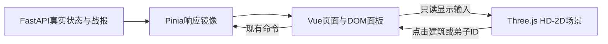

# HD-2D 场景迁移方案

2026-11-17（北京时间）。状态：七建筑 HD-2D 主城首版已代码接入，相关前端测试及最终构建已通过；未执行浏览器或视觉验收。用户已选择：**固定斜俯视，可拖动与缩放**，并明确授权直接复用对方美术和音乐、承担相应法律风险。本轮实际复用代码片段，未新增上游图片或音乐。

## 1. 已实施方向与范围

保留 Vue 3 面板、Pinia 命令编排、FastAPI 规则、SQLite 整档存档与 revision CAS，用 Three.js 建立 HD-2D 渲染层。本轮接入宗门主城，问道与宗门征讨的战斗画面仍为 Vue / SVG / CSS，后续单独迁移。HD-2D 指像素人物/贴图、具有真实高度与遮挡的场景、光照阴影和克制的景深；主城使用独立地形与建筑几何、透明人物立牌。



已新增并锁定 `three@0.185.1` 与开发期类型依赖 `@types/three@0.185.0`，用于正交3D空间、灯光、阴影、深度与后期，npm 锁文件同步更新。`pixi.js` 仍是保留的可选依赖，没有承担现有主城或战场；本轮没有清理该依赖或复制对方 pnpm 工作区。[O1][O2]

本方案改变画面技术与场景资产组织，不增加自治 AI、自由生活模拟、人物饥渴、真实寻路产出、多人系统或游戏引擎。现有玩法消耗、战斗、挂机、伤势、RNG 与存档结算继续按服务端真实结果执行。

## 2. 对方 HD-2D 实际用了什么

固定对照提交：`5ddc1a37d287bbc32232ab27cbbfd59ac188ccf1`。这里只确认源码结构，不宣称其平台性能已经由本次实机验证。

| 能力 | 对方源码依据 | 我们的取舍 |
|---|---|---|
| 正交相机、地面与高度分离 | `scene.ts:303`、`layout.ts:21`。[S1][S2] | 固定方位和俯角；平移、缩放围绕地面中心，限定范围，提供回到默认视野。首版不旋转。 |
| 太阳/环境光、阴影、色调映射 | `scene.ts:173`、`:312`、`:2671`。[S1] | 一套主光与环境光，沿现有晨昼暮夜更新；人物与建筑共用光照方向。灯火强调窗口和炼炉，避免大量实时点光。 |
| 像素人物立牌与正确遮挡 | `standee.ts:10`、`:43` 使用透明裁切、受光材质、自定义深度和投影材质。[S3] | 人物脚底锚定地面，透明裁切同时影响画面与拾取，脚底深度参与遮挡；人物使用接地阴影，没有复制上游完整投影材质。固定镜头简化朝向素材量。 |
| 像素采样 | `pixelSampling.ts:3` 通过材质标记及着色器片段处理缩放采样。[S4] | 先用统一纹素密度与合适贴图采样；确有缩放闪烁再引入定向的材质修正，不先复制全局 shader patch。 |
| 深度、移轴、散景、泛光、调色 | `scene.ts:191`、`post.ts:10`。[S1][S5] | 首版使用色调映射与可关闭的轻景深；“柔景”默认关闭，DOM文字独立绘制。未接入泛光、体积光、真实倒影或重散景。 |
| 画质、分辨率、生命周期 | `quality.ts:1`、`scene.ts:3067`、`:3087`。[S1][S6] | 限制像素比，后台停止绘制，卸载时释放GPU资源；手机先验证基础档，再启用重后期。 |

`scene.ts` 超过3000行，绑定 Atlas、拓扑、SVG视口、天气、人口名册、玩法协议、主题与画质体系；当前项目没有这些输入。[S1] 本轮仅改作 `standee.ts` 的脚底深度修正片段，没有整文件复制场景，也没有迁入 `town-shared`、Rust 内核、建镇器或世界进程。原许可、作者声明与修改范围已归档到 `licenses/my_ai_town/`。

## 3. 我方的渲染模块实现

`CityView.vue` 继续组织目标浮签、收取收益、建筑面板和底栏；原全景图、百分比热区及氛围层已替换为 `CityScene.vue` 场景宿主。模态框、资源栏、按钮、提示与键盘操作保留DOM，不画进 WebGL。[O2][O3]

本轮实际文件：

```text
frontend/src/rendering/hd2d/
  CityScene.vue      # Vue宿主，接收只读输入，发出点击事件，管理挂载/卸载
  cityScene.ts       # 场景、相机、光照、拾取与渲染生命周期
  cityModel.ts       # 纯视觉空间布局、真实弟子状态投影与相机范围
  cityBuildings.ts   # 七建筑几何/像素材质及必要的独立构件
  pixelSprites.ts    # 人物贴图、脚底深度、透明拾取和资源缓存/释放
  sceneGestures.ts   # 点击、拖动、双指缩放与取消手势
  postprocessing.ts  # 可关闭的轻景深，不包揽业务状态
```

`CityScene` 接收 `actors`（身份/立绘URL/真实值守与伤势显示）、`buildings`（ID、名称与当前说明）和 `lighting`；发出 `building(id)`、`disciple(id)`。宿主维护加载、失败、柔景与系统减少动画偏好，场景内部提供更新和销毁，不向页面暴露 Mesh、相机或材质。点击人物由 `CityView` 打开弟子堂并选中该弟子，键盘用户也可通过“山中同道”列表打开。

服务端响应变化时更新显示输入；动画帧仅更新场景内的轻微驻足姿态和相机，不让Vue每帧深度观察整份存档，也不把 Three.js 对象放入游戏store。当前战场继续使用 `battlePlayback.ts` 播放游标；后续按具体共用需要复用立牌/材质，不预先抽象任意世界引擎。

宿主不读 store、不发网络、不做岗位与收益决策。`CityView` 从现有响应生成只读显示输入，资源URL沿 `presentation/assetPaths.ts` 解析；点击结果回到现有 `open()`、弟子详情及 store 命令。[O2][O4] 不在渲染模块复制费用、解锁、伤势恢复或胜负规则。

现有 `config/ui/city.json` 是图片百分比热区，不能把 x/y 百分比直接当3D坐标。[O5] 本轮在 `rendering/hd2d/cityModel.ts` 维护固定场景的纯视觉布局，建筑几何与高度在 `cityBuildings.ts` 实现；按既有 `library/main_hall/dock/drill/tower/forge/alchemy` ID 对接catalog中的名称和panel映射。这里不复制建筑等级、消耗、解锁或产出等业务配置。**纯演出坐标未写入玩家存档，后端契约未改动。** 以后确需可配置地图时，再按现有Pydantic→OpenAPI→TS管线扩展，不绕过catalog另造业务目录。[O6]

人物出现位置来自真实状态的显示投影：值守者在演武场附近，出征者、忙碌者和外宗驻守者不出现在本宗；最多显示16名常驻弟子，优先保留值守者。首版以固定驻足和轻动作呈现，没有行走帧或自主寻路。视觉动作不能改变岗位或产生收益，浏览器关闭不影响补算；视觉节奏与玩法RNG分开。

## 4. 资产改造与可复用范围

最主要的成本是把“画好的空间”变成“能被遮挡、照明、缩放的独立空间部件”。已有文件的静态元数据核对如下；没有进行图片观感检查。

| 当前资产 | 实际情况 | 迁移用途 |
|---|---|---|
| `city-v03/scene_city_complete.png` | 1536×1024，无透明；七建筑和环境已画在同一图上 | 构图、配色与身份基准，必要时过渡展示；无法自动恢复各建筑体积与背后内容。[A1] |
| `trial-v03/scene_tower_trial.png` | 1536×1024，无透明 | 作为战台构图参考或远景，逐步改为有地面的独立空间。 |
| `trial-v03/` 的16名弟子、`art-foundation/enemies/` 的10名敌人 | 透明PNG、高512，单幅站姿，没有行走帧 | 首版立牌和原详情图复用；场景小尺寸的辨识度、像素密度、武器完整性由用户检查。 |
| `buildings/sprite_*.png` 的7栋旧建筑 | 透明PNG、宽512，高407–1133；来自旧版分层方案 | 本轮主城使用程序建筑；旧塔图仍供出征准备使用，其余资源保留，不登记为本轮新美术完成。[A1][A2] |

本轮采用：**立体地形/台阶/崖壁、程序搭建的七建筑体块与像素贴图，配已有二维人物立牌和程序环境装饰。** 近景道路、台基、建筑与人物具有独立高度和前后关系，原整图保留为构图与配色参考。对方也是混合方式：墙面贴图在Canvas逐像素绘制，特殊建筑有几何部件，部分树木和地标则用立牌。[A3]

代码首版已包含七建筑，覆盖原有全部功能入口，使用白玉平台、石阶、石径、青瓦、暖木、象牙白、玉绿与克制金色的共享材质。七建筑已接入不等于整城美术已验收；人物与门、台阶、屋檐的比例、像素密度、遮挡和小尺寸辨识仍由用户人工检查。

对方人物是21×29格的Q版、四向、程序分层现画；我方风格明确排除 `chibi`，现人物为完整三分之四站姿，不能原样替换人物生成器并视为画风延续。[A4] 当前立绘已有绘制光照，首版立牌要检查材质调色和投影，避免再受强动态光后明暗失真；走路朝向和骨骼分层需另做适配。新增或重做人物、复杂建筑切片时沿用三类代表试稿，再扩批；付费生成的模型和上限在该制作任务中另行明确，本次不调用生图。[A5]

### 上游代码、图片与音乐

用户已明确授权直接复用对方美术和音乐，并表示承担相应法律风险；本任务按该授权执行，不再把许可讨论作为实施阻断或待确认事项。来源原文仍客观保留，实际复用范围按文件登记：

- 原创代码和文档采用 PolyForm Noncommercial 1.0.0，分发说明含许可和 `Required Notice`。[L1] 本轮改作 `standee.ts` 的 `uprightDepth` 与立牌材质接入片段，目标为 `pixelSprites.ts`。
- 美术、自有音效和音乐的素材原文写明“允许在本项目及其非商业衍生版本中使用和随项目分发”，并写明“不额外授予……用于其他项目的许可”。该原文作为来源事实记录，不改写为作者另行授予我方授权。[L2] 本轮未复制这些图片或音频。
- Kenney脚步声明确为CC0，模型和其他依赖另有许可。[L2] 后续实际选用图片或音乐时记录上游/本地路径；音乐的静音、音量、首次手势与后台播放行为随接入一并实现。本轮没有新增音景。

来源归档为 [`licenses/my_ai_town/LICENSE`](../../licenses/my_ai_town/LICENSE)、[`NOTICE`](../../licenses/my_ai_town/NOTICE) 和 [`SOURCE.md`](../../licenses/my_ai_town/SOURCE.md)，记录上游提交、本地目标和修改范围。建筑几何与Canvas纹理由本项目生成，人物继续使用本地 `trial-v03` 资源；未把第三方代码登记成我方付费生图。后续图片仍沿 `assetPaths.ts` 解析本地URL。[O4]

## 5. 交互、资源与生命周期

- 相机固定斜俯视。桌面拖动平移、滚轮缩放；手机单指平移、双指缩放。拖动与点击有明确阈值，抬手结束拖动时不能误开建筑；交互只在场景区域接管，不抢弹窗滚动和双指操作之外的页面手势。
- 用可拾取实体的稳定ID命中建筑与人物，世界坐标投影到DOM标签；拖动/缩放/窗口变化同步标签。场景内无论视角如何移动，七个入口仍可由现有底栏和键盘抵达。
- 主城按需异步加载场景模块与当前资产。角色纹理按资产键缓存共享，避免同图重复加载；每个人物的几何和材质随实体替换释放。切档重建宿主，切战斗按页面挂载关系释放，首版只保留一个活动场景上下文。
- `ResizeObserver` 更新相机比例、画布及后期尺寸；`visibilitychange` 停止后台绘制。系统减少动画偏好停用人物轻动作，保留可操作的静态状态；人物图片异步完成后可触发静态重绘。
- 场景获得焦点后用方向键平移、加减键缩放、`Home` 复位，画面内同时提供视野按钮。“柔景”默认关闭，可开启轻景深；手机限制像素比，DOM文字独立绘制。阴影与后期效果的实际设备表现尚未人工验收，未引入泛光、倒影、体积光或多重采样。
- 卸载取消RAF、观察器、手势/可见性监听，释放几何、材质、纹理、后期渲染目标与WebGL上下文；共享纹理按所有者统一释放，不由每个角色重复销毁。上游释放路径值得参考，但不能复制不适用的资源列表。[S1]
- WebGL创建或上下文失败时给明确反馈和重新载入按钮，现有DOM底栏与功能面板继续可用。部分人物图片失败时提示使用“山中同道”列表查看，不建立第二套渲染引擎。

## 6. 分阶段实施与验收

| 阶段 | 具体交付 | 验证与状态 |
|---|---|---|
| 0. 定场景与资产 | 确定现有七建筑功能关系、固定相机、人物比例、像素纹理、建筑高度、光照和资产复用范围 | 已完成：沿用七建筑 ID；未改变服务端配置、存档或接口。 |
| 1. 主城代码首版 | 七建筑、地形与人物立牌全部接入 HD-2D；原底栏、目标、收取、弹窗、昼夜、真实值守/出征/驻守投影联通；可拖动缩放、键盘操作与轻景深开关 | 代码已实现。相关测试54/54通过，`npm run build` 通过。没有运行浏览器或视觉验收；七建筑已接入不代表美术、遮挡和手机体验已确认，用户人工验收。 |
| 2. 战斗画面迁移 | 复用同类相机/材质能力建立问道平台、擂台和宗主场景，替换 `BattleStage` 的画面实现 | 后续工作，尚未实施。`battleUnitsAt` 与服务端事件须继续决定血量、状态、伤害和胜负；摘要/完整/只看结果/跳过/后台行为按原契约保持。[O7] |
| 3. 后续收口 | 按用户反馈迭代视觉；若后续接入素材，补来源记录；战斗迁移后再决定是否清理被替换的实现 | 当前第三方代码、来源记录和规范已更新。本轮没有复用上游图片或音乐，没有新增音景；没有进行部署或发布。桌面、390px、光照、人物比例、遮挡、手势、失败态和性能由用户人工检查。 |

阶段1的七建筑主城是可运行的代码首版，包含轻微人物驻足而没有行走帧或寻路。它已接入全城功能入口，但不表示美术风格、所有遮挡与小尺寸人物可读性、390px 手势体验或性能已人工验收；不宣称已有战斗 HD-2D、音景或高端后期。

已同步 `ARCHITECTURE.md`、`frontend/README.md`、`DESIGN.md` 与 `ART_DIRECTION.md`：记录 Three.js 主城职责、固定镜头、纯视觉世界坐标、立牌/建筑关系及人工验收边界。画风继续沿用现有青绿细像素，不因本轮改变公共版本。

## 7. 验证范围

本轮实现的直接相关检查：

- `node --test tests/city-scene.test.mjs tests/scene-gestures.test.mjs tests/asset-paths.test.mjs tests/game-store.test.mjs tests/sect-management.test.mjs tests/city-sprites.test.mjs`：54/54通过。
- `npm run build`：退出码0，`vue-tsc` 与 Vite 构建成功。Vite 提示异步 `cityScene` chunk 为 551.42 kB（gzip 140.82 kB），超过 500 kB 建议阈值；这是后续体积优化提醒，不影响本次构建通过。
- 本轮未改 catalog、Pydantic 源模型、接口契约、后端战斗或 RNG，没有运行后端业务测试。因本地生成类型落后于现有源模型，已执行 `backend\.venv\Scripts\python.exe backend/scripts/export_openapi.py` 与 `npm run gen:api` 刷新生成产物，均退出0；生成产物保持忽略，不手改或提交。
- 按用户限定，本轮不运行浏览器或视觉验收。桌面/390px、晴昼/月夜、近远缩放、弹窗遮挡、长文本、加载失败、减少动画、后台恢复和设备性能由用户人工检查；未提供设备测量前不承诺“手机稳定60fps”。

### 连续地面与镜头适配迭代（2026-11-17）

针对主城看起来过小、像孤立小岛的问题，场景改为 320×320 的连续平地，四条石路从城心分别向南北东西延伸至周边平地；场景几何和人物组统一使用 1.1 世界缩放。正交相机默认缩放设为 1.15；视口变窄时按高度与相机俯角动态计算最小缩放，确保完整山门和连续地面仍可见，最大缩放为 2。此调整只改变演出空间与相机，不改变建筑 ID 或玩法状态。

人物接地使用缩放后的场景组做向下射线采样，再将命中高度换回人物局部世界尺度；射线起点与最远距离同步按 1.1 缩放，避免固定射线长度在缩放后提前终止。对应回归检查全部16个常驻锚点及周边采样点落在地面，且不被建筑或石灯抬高。

本轮最新验证：

- `node --test tests/city-scene.test.mjs tests/scene-gestures.test.mjs tests/city-sprites.test.mjs tests/asset-paths.test.mjs tests/game-store.test.mjs tests/sect-management.test.mjs`：56/56通过。
- `npm run build`：退出码0，类型检查与 Vite 构建成功。异步 `cityScene` chunk 为552.24 kB（gzip 141.12 kB），高于500 kB建议阈值，作为后续体积优化提醒。
- `git diff --check`：退出码0。
- `city-scene.test.mjs` 通过几何与相机投影断言：16:9 和窄屏比例下，缩放与平移边界处视口四角均命中连续地面；四向道路在城外采样点仍高于地面。此验证不是浏览器渲染或视觉验收；桌面/390px构图、地面与道路观感由用户人工检查。

### 广场扩宽与人物巡游迭代（2026-11-17）

中央广场从 11×7 扩为 `CITY_PLAZA` 定义的 26×22，七栋建筑退到广场外围，入口道路按 `CITY_BUILDING_PATHS` 接入广场边缘，南侧工坊绕外侧回接，保留开阔城心。默认视野继续使用 1.15 缩放，先看广场，外围建筑通过拖动巡视；底栏保持全部功能入口可达。空间布局仍是前端纯视觉数据，没有新增玩法规则或存档字段。

本段更新前述首版固定驻足的表现：新增 `cityMotion.ts`，闲置且无伤的常驻弟子沿广场内 3.6×2 的短矩形路线低速停走，速度为每秒0.55–0.71个布局单位，人物 ID 决定错峰节奏；值守者与伤员在锚点驻足。减少动态效果时回到锚点静止，进入后台时暂停场景演出时钟，回来不追赶离开的时间。该运动不请求接口、不消费玩法 RNG，不改变岗位、收益或出征状态。

`cityScene.ts` 根据当前巡游位置向实际地表采样接地高度，`pixelSprites.ts` 在逐帧移动中保留已创建的人物 ID、纹理与几何，接地阴影同步位置和高度，轻微起伏只作用于人物。复用现有单幅站姿，没有制作四向行走帧、骨骼或新增生图资产；代码能够移动不等于行走帧美术已完成。

本轮验证：

- 前端执行 `node --test tests/city-motion.test.mjs tests/city-scene.test.mjs tests/city-sprites.test.mjs tests/scene-gestures.test.mjs tests/asset-paths.test.mjs`：33/33通过，覆盖广场留白与入口道路、巡游连续性和静止条件、ID错峰、路线接地、移动资源复用与阴影同步。
- `npm run build`：退出码0，类型检查与Vite构建通过；异步 `cityScene` chunk为554.04 kB，gzip141.89 kB，仍触发500 kB建议阈值提示。
- 仓库根目录执行 `backend\.venv\Scripts\python.exe tools/check_rng_usage.py`、`git diff --check`：均退出码0。
- 逐帧巡游接地仅查询广场的三个可行走表面，测试确认其高度与全场景采样一致；值守人物在位置或状态更新时采样全场景。未运行浏览器或视觉验收，桌面与390px构图、人物位移观感及遮挡仍由用户人工检查。

## 8. 源码索引

- **S1**：[渲染、灯光、后期、相机与释放](https://github.com/mewamew/my_ai_town/blob/5ddc1a37d287bbc32232ab27cbbfd59ac188ccf1/frontend/town-2d/src/map/hd2d/scene.ts#L173)。关键行：创建渲染器173、后期191、相机303、光照2671、尺寸3067、释放3087。
- **S2**：[正交斜俯视与高度投影](https://github.com/mewamew/my_ai_town/blob/5ddc1a37d287bbc32232ab27cbbfd59ac188ccf1/frontend/town-2d/src/map/hd2d/layout.ts#L21)。
- **S3**：[立牌、透明裁切与正确深度](https://github.com/mewamew/my_ai_town/blob/5ddc1a37d287bbc32232ab27cbbfd59ac188ccf1/frontend/town-2d/src/map/hd2d/standee.ts#L43)。
- **S4**：[像素采样的材质标记与着色器修改](https://github.com/mewamew/my_ai_town/blob/5ddc1a37d287bbc32232ab27cbbfd59ac188ccf1/frontend/town-2d/src/map/hd2d/pixelSampling.ts#L3)。
- **S5**：[真实深度与景深处理](https://github.com/mewamew/my_ai_town/blob/5ddc1a37d287bbc32232ab27cbbfd59ac188ccf1/frontend/town-2d/src/map/hd2d/post.ts#L10)。
- **S6**：[画质档与像素比上限](https://github.com/mewamew/my_ai_town/blob/5ddc1a37d287bbc32232ab27cbbfd59ac188ccf1/frontend/town-shared/src/quality.ts#L1)。
- **O1**：[我方当前前端依赖](../../frontend/package.json#L13)。
- **O2**：[主城入口及面板组织](../../frontend/src/views/CityView.vue#L18)。
- **O3**：[应用外壳与全局提示](../../frontend/src/App.vue#L21)。
- **O4**：[统一资产路径](../../frontend/src/presentation/assetPaths.ts#L1)。
- **O5**：[现有百分比热区配置](../../config/ui/city.json#L1)。
- **O6**：[现有城市配置契约](../../backend/app/models/api.py#L309)、[catalog读取](../../backend/app/api/catalog.py#L25)。
- **O7**：[服务端战报播放转换](../../frontend/src/rendering/battlePlayback.ts#L1)、[当前战场生命周期与模式](../../frontend/src/rendering/BattleStage.vue#L68)。
- **A1**：[当前整图与旧图身份](../../assets/masters/city-v03/README.md#L5)、[当前布局说明](../../config/ui/city.json#L4)。
- **A2**：[旧独立建筑来源](../../assets/prompts/city_layers.json#L1)、[透明处理工具](../../tools/chroma_key.py#L4)。
- **A3**：[上游程序像素纹理](https://github.com/mewamew/my_ai_town/blob/5ddc1a37d287bbc32232ab27cbbfd59ac188ccf1/frontend/town-2d/src/map/hd2d/textures.ts#L8)、[立体建筑部件](https://github.com/mewamew/my_ai_town/blob/5ddc1a37d287bbc32232ab27cbbfd59ac188ccf1/frontend/town-2d/src/map/hd2d/structures.ts#L18)、[地标立牌](https://github.com/mewamew/my_ai_town/blob/5ddc1a37d287bbc32232ab27cbbfd59ac188ccf1/frontend/town-2d/src/map/hd2d/landmarks.ts#L22)。
- **A4**：[上游Q版人物](https://github.com/mewamew/my_ai_town/blob/5ddc1a37d287bbc32232ab27cbbfd59ac188ccf1/frontend/town-2d/src/map/hd2d/villagerSprite.ts#L10)、[我方当前风格与排除项](../../config/style/style.json#L4)。
- **A5**：[人物身份与姿态](../../ART_DIRECTION.md#L49)、[试稿流程](../../ART_DIRECTION.md#L84)。
- **L1**：[非商业改作与分发通知](https://github.com/mewamew/my_ai_town/blob/5ddc1a37d287bbc32232ab27cbbfd59ac188ccf1/LICENSE#L30)、[作者与第三方声明](https://github.com/mewamew/my_ai_town/blob/5ddc1a37d287bbc32232ab27cbbfd59ac188ccf1/NOTICE#L1)。
- **L2**：[图片音效与音乐范围](https://github.com/mewamew/my_ai_town/blob/5ddc1a37d287bbc32232ab27cbbfd59ac188ccf1/licenses/ASSETS.txt#L7)、[Kenney来源与CC0](https://github.com/mewamew/my_ai_town/blob/5ddc1a37d287bbc32232ab27cbbfd59ac188ccf1/licenses/ASSETS.txt#L28)。

## 9. 本次交付状态

本次交付为七建筑 HD-2D 主城代码首版，包含固定斜俯视、拖动缩放、点击功能建筑和人物详情、真实弟子状态映射、昼夜、阴影及默认关闭的轻景深。Vue 面板和底栏、服务端玩法、整档存档、CAS 与确定性RNG保持现有职责；战斗仍未迁移。

直接相关前端测试54/54通过，`npm run build` 通过；Vite 异步场景包有一条超过建议阈值的体积提醒。没有运行浏览器、视觉验收、付费生图或部署。用户已授权素材复用，本轮实际仅改作上游立牌深度代码，许可和来源已归档；尚未新增上游图片或音乐。提交与推送状态见本次交付消息；视觉与设备性能待用户人工检查。
